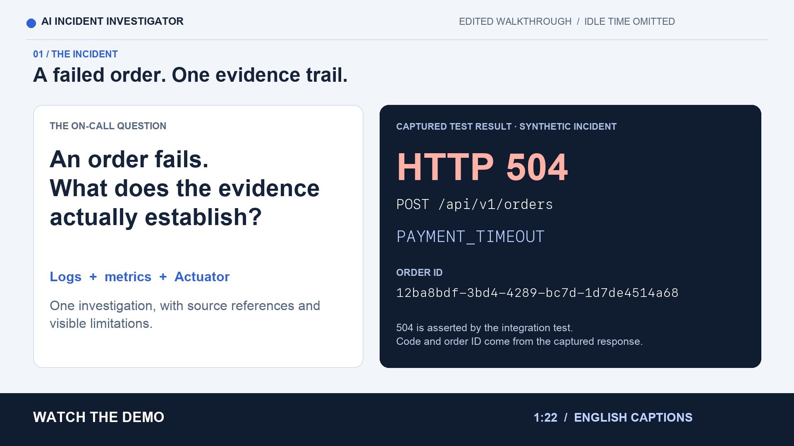
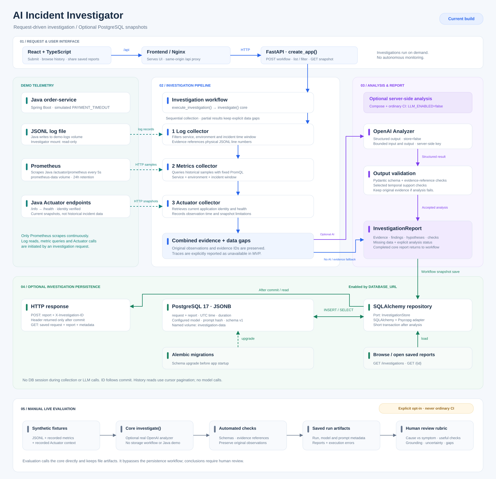

# AI Incident Investigator

[](https://github.com/woody-ai-dev/ai-incident-investigator/actions/workflows/ci.yaml?query=branch%3Amain)
[](https://github.com/woody-ai-dev/ai-incident-investigator/releases/latest)

An incident investigation assistant that helps on-call engineers and SREs turn
service telemetry into evidence-backed reports.

The MVP collects evidence from JSONL logs, Prometheus, and Spring
Boot Actuator, and optionally uses OpenAI for structured analysis. A Java demo
service generates a reproducible payment-timeout scenario. Reports combine
historical log records and metric observations with current application identity
and health snapshots. Automated remediation is not implemented.

## Current capabilities

- FastAPI endpoints for health checks and investigation requests.
- Validated service, environment, and timezone-aware investigation windows.
- JSONL collection filtered by service, environment, and time.
- Log evidence with references to physical lines in the source file.
- Historical Prometheus evidence filtered by service, environment, and time.
- Metric summaries with query references, sample counts, minimum, maximum, and last values.
- Current Actuator info and health snapshots after service/environment identity checks.
- Snapshot timestamps recorded when each response is retrieved, distinct from the incident window.
- Partial collection with explicit reporting of unavailable data and limits.
- Optional structured LLM analysis with evidence-reference validation.
- Evidence-preserving fallback when analysis fails or is rejected.
- A Spring Boot demo service with normal and payment-timeout modes.
- A React and TypeScript UI for submitting investigations and reviewing reports.
- Docker images and a four-service Docker Compose demo.
- Python and frontend tests, Java API tests, and telemetry integration checks.
- An opt-in LLM evaluation runner with repeatable scenarios, run metadata, and checkpoints.

With analysis disabled, reports contain evidence and data gaps, with empty
findings and hypotheses. A structurally valid model report does not prove that
its explanation is correct.

## Try the MVP

Start with the [Docker Compose quick start](#quick-start-with-docker-compose).
The default demo runs locally without an OpenAI API key. Create a controlled
payment timeout, investigate it in the UI, inspect evidence and data gaps, and
export the report as JSON.

- [Demo walkthrough and recording](docs/demo.md)
- [Validation record and real-model evaluation limits](docs/validation/2026-10-16.md)
- [Release notes for v0.1.0](docs/releases/v0.1.0.md)
- [GitHub release guide](docs/releasing.md)

## Recorded demo



[Download the MP4](https://github.com/woody-ai-dev/ai-incident-investigator/releases/download/v0.1.0/mvp-demo.mp4) — 1:22, Full HD 16:9,
English captions. Download the file and open it in your browser or video player.
This edited walkthrough uses real browser footage and an
unedited model response on synthetic telemetry. Idle time and repetitive
navigation are removed; close-ups and labelled excerpts explain the evidence.
The captions identify remaining model interpretation errors; this assistant
requires engineering review of its conclusions. The
[download the full captioned recording](https://github.com/woody-ai-dev/ai-incident-investigator/raw/refs/tags/v0.1.0/docs/assets/mvp-demo-full.mp4) (1:55) is also available.
See the
[actual exported report](docs/validation/live-ui-2026-10-16.json) and
[validation notes](docs/validation/2026-10-16.md#fresh-ui-investigation).

## Architecture



[Editable draw.io diagram](docs/architecture/architecture.drawio)

The investigator reads the shared log file, queries the Prometheus HTTP API,
and retrieves Actuator context when an investigation is requested and those
sources are configured. Prometheus scrapes the Java service every five seconds
independently of investigation requests. Actuator is queried directly and
returns current snapshots rather than historical incident observations.

The metrics collector uses three fixed queries. HTTP clients cannot supply
arbitrary PromQL or select a Prometheus server in the investigation payload.
The server address comes from application configuration. Actuator has one
configured service/environment target; the request cannot select its URL.

The services run as separate processes and share a telemetry contract.
The demo payment gateway is a simulation; there is no external payment provider
or order database.

## Quick start with Docker Compose

Requirements:

- Docker Engine with Docker Compose, or Docker Desktop.
- A running Docker daemon.
- Network access for the first image build and dependency downloads.
- Ports 3000, 8000, 8081, and 9090 available on the host.

Run commands from the repository root:

```bash
docker compose config --quiet
docker compose up --build --wait --wait-timeout 180
```

The first command validates the configuration. The second builds the images,
starts the services, and waits for their health checks.

| Service | Address |
| --- | --- |
| Investigator health | [GET /health](http://127.0.0.1:8000/health) |
| Investigation UI | [Local interface](http://127.0.0.1:3000) |
| Investigator API documentation | [Swagger UI](http://127.0.0.1:8000/docs) |
| Order-service health | [GET /actuator/health](http://127.0.0.1:8081/actuator/health) |
| Order-service identity | [GET /actuator/info](http://127.0.0.1:8081/actuator/info) |
| Order creation | `POST http://127.0.0.1:8081/api/v1/orders` |
| Java metrics exporter | [GET /actuator/prometheus](http://127.0.0.1:8081/actuator/prometheus) |
| Prometheus interface | [Prometheus UI](http://127.0.0.1:9090) |

The Compose demo enables metric collection with
`PROMETHEUS_URL=http://prometheus:9090` and Actuator collection with
`ACTUATOR_URL=http://order-service:8081/actuator/`,
`ACTUATOR_SERVICE=order-service`, and `ACTUATOR_ENVIRONMENT=local` in the
investigator's environment. It explicitly disables LLM analysis and requires
no API key.
The host does not need a JDK to run the container demo; the Java image includes
the required build and runtime environments. Host-side check scripts require uv.

## Check the log investigation demo

Install the host-side Python environment:

```bash
uv python install
uv sync --locked --dev
```

Run the check against the running Compose services:

```bash
uv run --locked python scripts/check_compose_demo.py
```

The script:

1. Checks both health endpoints.
2. Creates an order and expects HTTP 504 with PAYMENT_TIMEOUT.
3. Uses the returned order ID and a recent UTC time window to investigate.
4. Validates the response against InvestigationReport.
5. Requires timeout evidence for that exact order.
6. Requires analysis_status to be not_requested.

An example successful result:

```text
Compose demo passed: order=<UUID>; evidence=<count>; analysis_status=not_requested.
```

Evidence counts vary with framework logging, metric and Actuator availability,
and the selected time window. This check requires the created order's log
evidence; it does not require metric or Actuator evidence.

## Check the Prometheus demo

Prometheus reads `observability/prometheus/prometheus.yaml`, mounted into its
container as `/etc/prometheus/prometheus.yml`. It scrapes the Java service every
five seconds and retains metrics for 24 hours in the `prometheus-data` volume.

Validate the running Prometheus configuration and check metrics collection:

```bash
docker compose exec -T prometheus \
  /bin/promtool check config /etc/prometheus/prometheus.yml

uv run --locked python scripts/check_prometheus_demo.py
```

The metrics check:

1. Checks that the Java metrics endpoint is reachable.
2. Waits for a fresh scrape, avoiding data left over from a previous run.
3. Requires the order-service target to report `up = 1`.
4. Requires JVM heap memory metrics.
5. Creates an order and expects HTTP 504 with `PAYMENT_TIMEOUT` and an order ID.
6. Waits for the HTTP 504 request counter to increase.

An example successful result:

```text
Prometheus demo passed: order=<UUID>; http_504_count=1->2; heap_bytes=<number>.
```

Counter and memory values vary between runs. The counter represents aggregated
requests. Order IDs remain in logs and are not added as metric labels.
The check assumes the Java service is not restarted while it runs.

Open the Prometheus interface and try these queries:

```promql
up{service="order-service",environment="local"}
```

```promql
sum(
  http_server_requests_seconds_count{
    service="order-service",
    environment="local",
    uri="/api/v1/orders",
    method="POST",
    status="504"
  }
)
```

```promql
sum(
  jvm_memory_used_bytes{
    service="order-service",
    environment="local",
    area="heap"
  }
)
```

`up = 1` means scraping succeeded; a business operation can still fail.
The `_count` series measures completed requests, while the heap gauge is in bytes.
An empty result means no matching series are available, not necessarily zero
failures. All telemetry demo checks run without live LLM analysis.

## Check logs and metrics in one investigation

Run the integration check against the running Compose services:

```bash
uv run --locked python scripts/check_investigation_metrics.py
```

The script:

1. Creates an order and validates HTTP 504, PAYMENT_TIMEOUT, and the order UUID.
2. Requests an investigation starting 30 seconds before the order was created.
3. Repeats investigation requests with an updated end time while waiting for scrapes.
4. Requires the simulated timeout log for that exact order.
5. Requires `metric-up`, `metric-jvm-heap`, and `metric-http-504-counter` evidence.
6. Requires `analysis_status` to be `not_requested`.

An example successful result:

```text
Investigation metrics demo passed: order=<UUID>; metric_evidence=3; analysis_status=not_requested.
```

The polling budget is 30 seconds; an in-flight HTTP request may extend the
elapsed time. Logs associate the timeout with the order UUID. Metric evidence
provides aggregated service context and does not identify that order.
The separate Prometheus check verifies that a newly generated timeout increases
the counter; this integration check verifies that metrics reach the report.

## Metric evidence semantics

The collector evaluates fixed queries for the requested service and environment:

| Evidence ID | Observation |
| --- | --- |
| `metric-up` | Minimum `up` across observed targets. Zero means at least one observed target failed to scrape. |
| `metric-jvm-heap` | Sum of JVM heap usage in bytes across matching series. |
| `metric-http-504-counter` | Sum of the cumulative HTTP 504 counter for `POST /api/v1/orders`. |

Each evidence item contains the observed sample count, minimum, maximum, last
value, and the full `query_range` URL. The collector summarizes the queried
window; it does not persist the raw time series.

Evaluation uses a five-second step and a fifteen-second lookback, suited to the
demo's five-second scrape interval. Evaluation timestamps are not scrape
timestamps: a value can come from a preceding scrape, including one just before
the investigation start. Query bounds are rounded inward to milliseconds so
that evaluation points stay in `[start_time, end_time)`.

Empty results are reported as missing data rather than converted to zero.
HTTP errors, invalid responses, query annotations, and missing evaluation
points are reported in `missing_data`. Other successfully collected metrics
and log evidence are retained.

The HTTP counter is cumulative and may reset when a process restarts. Its value
is not the number of failures during the investigation window. Heap usage alone
does not establish a memory leak, and successful scraping does not establish
business health. Queries aggregate matching targets; they do not prove that
all expected instances were observed. The HTTP query currently targets the
order-service demo route rather than discovering arbitrary application routes.

Query references can be repeated while the data is retained, but they are not
immutable snapshots. Compose references use the internal hostname `prometheus`;
when replaying from the host, replace it with the published
`http://127.0.0.1:9090` base address and keep the query parameters.

## Reproduce the timeout manually

```bash
curl -i http://127.0.0.1:8081/api/v1/orders \
  -H 'Content-Type: application/json' \
  -d '{"productId":"book-1","quantity":2}'
```

The response should be HTTP 504 with code PAYMENT_TIMEOUT and an orderId.
Health remains UP because the application itself is running.

The simulation throws a controlled exception immediately. It does not reproduce
an actual network delay or explain why a real dependency would be slow.

## Container design

- Python dependencies are installed from uv.lock without development packages.
- The Python application is installed in non-editable mode.
- Java is built with Maven Wrapper and JDK 25, then runs in a JRE image.
- Python and Java run as a non-root user with UID 10001.
- The frontend serves its built assets from an unprivileged Nginx image.
- Java writes logs to the named demo-logs volume.
- Python mounts the same volume read-only.
- Prometheus runs as the image's non-root user and stores metrics in its own volume.
- Its configuration is mounted read-only; a missing source file stops startup.
- Root filesystems are read-only; /tmp is a temporary filesystem.
- Host ports are bound to 127.0.0.1.
- Prometheus starts after the Java health check succeeds.
- The investigator starts after both Java and Prometheus health checks succeed.
- The frontend starts after the investigator health check succeeds.
- LLM_ENABLED is explicitly false in default Compose.
- Default Compose does not pass OPENAI_API_KEY to the containers.
- Docker build contexts include only the files required for each image.

The Python and Java HTTP servers listen on 0.0.0.0 inside their containers.
Frontend Nginx listens on port 8080 and is published on host port 3000.
This allows Docker's published ports to reach the applications.

The Compose configuration uses /data/order-service.jsonl for both the Java log
destination and the Python log source.

## Stop the demo

Inspect services and logs:

```bash
docker compose ps
docker compose logs --tail=100
```

Stop the services while retaining captured logs and metrics:

```bash
docker compose down
```

For a fresh capture, remove both demo volumes:

```bash
docker compose down --volumes
```

The last command deletes captured logs and stored Prometheus metrics.
Reading logs from Python does not delete or consume them. Java continues
appending to the active log file and rotates it according to its Logback
configuration. The investigator currently reads only the active file.

## Repository structure

```text
Dockerfile                         Python image
.dockerignore                      Python build context exclusions
compose.yaml                       Local container demo without model calls
compose.llm.yaml                   Opt-in live model override
.github/workflows/ci.yaml           CI checks
src/ai_incident_investigator/       API, models, collection, and analysis
frontend/                          React/TypeScript UI, tests, and Nginx image
tests/                             Python tests
evals/                             Synthetic scenarios and review rubric
docs/                              Architecture, evaluation, demo, and release guides
scripts/check_compose_demo.py       Container log investigation check
scripts/check_prometheus_demo.py    Prometheus collection check
scripts/check_investigation_metrics.py  Combined log and metric report check
scripts/check_investigation_context.py  Current Actuator report check
scripts/check_demo_logs.py          Java-to-Python log contract check
observability/prometheus/           Prometheus scrape configuration
examples/logs.jsonl                 Synthetic example logs
demo-services/order-service/       Java application and its Docker image
.env.example                       Configuration template without secrets
data/                              Local runtime data, excluded from Git
```

## Local development

For development without containers, install uv and JDK 25.
Maven 3.9.16 is provided through the committed Maven Wrapper.

```bash
uv python install
uv sync --locked --dev
```

On macOS, select JDK 25 in each terminal that builds or runs the Java service:

```bash
export JAVA_HOME=$(/usr/libexec/java_home -v 25)
export PATH="$JAVA_HOME/bin:$PATH"
```

These exports apply to the current terminal session. Confirm the JDK used by Maven:

```bash
./demo-services/order-service/mvnw -version
```

The output should report Java 25. The POM's `java.version` sets the compilation
target; it does not select the JDK that launches Maven. Use the same JDK 25
as CI and the Java container image.

Build and test the Java service:

```bash
./demo-services/order-service/mvnw \
  -f demo-services/order-service/pom.xml -B -ntp clean verify
```

Validate its generated timeout logs:

```bash
uv run --locked python scripts/check_demo_logs.py \
  demo-services/order-service/target/test-logs/timeout.jsonl
```

Stop Compose before starting local services on the same ports.

## Capture a local incident

Start the Java service in terminal A:

```bash
mkdir -p data

DEMO_PAYMENT_MODE=payment-timeout \
DEMO_LOG_FILE="$PWD/data/order-service-timeout.jsonl" \
java -jar demo-services/order-service/target/order-service-0.1.0.jar
```

Create an order in terminal B:

```bash
curl -i http://127.0.0.1:8081/api/v1/orders \
  -H 'Content-Type: application/json' \
  -d '{"productId":"book-1","quantity":2}'
```

Stop Java with Ctrl+C after capturing the error. Start the investigator in
terminal A:

```bash
LLM_ENABLED=false \
PROMETHEUS_URL= \
ACTUATOR_URL= \
ACTUATOR_SERVICE= \
ACTUATOR_ENVIRONMENT= \
INVESTIGATOR_LOG_PATH="$PWD/data/order-service-timeout.jsonl" \
uv run --locked uvicorn ai_incident_investigator.main:app --reload
```

This capture uses logs only. Empty `PROMETHEUS_URL` and all three empty
`ACTUATOR_*` variables explicitly disable the HTTP sources for this local run,
even if the terminal previously exported their configuration.

Generate a request from the captured timestamps in terminal B:

```bash
uv run --locked python - <<'PY'
import json
from datetime import datetime, timedelta
from pathlib import Path

path = Path("data/order-service-timeout.jsonl")
records = [json.loads(line) for line in path.read_text().splitlines() if line.strip()]
timestamps = [datetime.fromisoformat(record["timestamp"]) for record in records]

request = {
    "service": "order-service",
    "environment": "local",
    "start_time": min(timestamps).isoformat(),
    "end_time": (max(timestamps) + timedelta(seconds=1)).isoformat(),
    "description": "Order creation returns HTTP 504.",
}

Path("data/investigation-request.json").write_text(
    json.dumps(request, indent=2),
    encoding="utf-8",
)
PY

curl -i http://127.0.0.1:8000/investigations \
  -H 'Content-Type: application/json' \
  --data-binary @data/investigation-request.json
```

For the success scenario, restart Java with DEMO_PAYMENT_MODE=normal and a fresh
log filename. A valid order returns HTTP 201 with status ACCEPTED.
Orders are not persisted.

## Prometheus configuration

`PROMETHEUS_URL` is optional. An unset or empty value disables metric collection;
reports then include a data gap stating that the source is not connected.

| Run mode | Base URL |
| --- | --- |
| Investigator in Compose | `http://prometheus:9090` |
| Local investigator using the published Prometheus port | `http://127.0.0.1:9090` |

For a local investigator, set the address in the process environment or in a
private `.env` file loaded with `uv run --env-file .env`. The configured
Prometheus must contain telemetry for the same service, environment, and time
window as the logs. Connecting a server does not guarantee matching data.

Configuration accepts an HTTP or HTTPS base URL of at most 512 characters,
without embedded credentials, query parameters, or fragments. Authentication
configuration is not implemented. A client is opened for each investigation
and closed afterwards; the three metric queries share that client.

## Spring Boot Actuator context

The investigator can collect current application context from
`/actuator/info` and `/actuator/health`.

Configure all three variables together:

- `ACTUATOR_URL`: base URL of the Actuator endpoints, including `/actuator/`.
- `ACTUATOR_SERVICE`: service assigned to this endpoint.
- `ACTUATOR_ENVIRONMENT`: environment assigned to this endpoint.

All three unset or empty values disable Actuator collection. A partially
configured target is invalid and prevents startup. The base URL accepts HTTP
or HTTPS, at most 512 characters, without embedded credentials, query
parameters, or fragments. Authentication configuration is not implemented.

| Run mode | Actuator base URL |
| --- | --- |
| Investigator in Compose | `http://order-service:8081/actuator/` |
| Local investigator using the published Java port | `http://127.0.0.1:8081/actuator/` |

The request's service and environment must match the configured target before
any Actuator request is sent. The collector then requires `/info` to provide
`app.name`, `app.environment`, and `app.version`, and checks the declared
name/environment before collecting health. The demo publishes these fields
through `info.app.*` and `management.info.env.enabled=true`; Maven replaces
`@project.version@` with the POM version during the build.

Only application name, environment, version, and overall health status are
included in the report. Additional info fields and health component details
are ignored. HTTP 503 with health `DOWN` or `OUT_OF_SERVICE` is retained as
an observation rather than treated as a collection failure.

| Evidence ID | Observation |
| --- | --- |
| `actuator-info` | Current application name, environment, and version. |
| `actuator-health` | Current overall health status and response HTTP status. |

Actuator observations are current snapshots with their actual retrieval
timestamps and `end_time=None`. They do not establish the application's state
during a historical incident window. This limitation is reported in
`missing_data`; an additional note identifies snapshots outside the requested
window. Each reference is the requested endpoint URL, not a persisted copy
of the response. Repeating the URL retrieves a new snapshot.

If Actuator is unavailable or its identity cannot be verified, collected
logs and Prometheus evidence are retained.

The demo can report health `UP` while order requests return a simulated
HTTP 504. Overall application health does not prove that every business
operation succeeds.

Run the Actuator integration check with:

```bash
uv run --locked python scripts/check_investigation_context.py
```

The check requires `actuator-info` and `actuator-health` evidence, the demo's
name/environment/version, current health `UP`, and `analysis_status=not_requested`.
It deliberately requests a historical window that ends before the HTTP call,
then verifies that snapshot timestamps fall inside the actual retrieval
interval and have no end time. This detects snapshots incorrectly dated as
historical evidence.

An example successful result:

```text
Investigation context demo passed: actuator_evidence=2; analysis_status=not_requested.
```

## Optional LLM analysis

Live analysis is optional. The default Compose demo and CI do not use it.

For local live analysis, create a private .env file using .env.example as a
template. Update an existing .env instead of overwriting it.

```dotenv
INVESTIGATOR_LOG_PATH=data/order-service-timeout.jsonl
LLM_ENABLED=true
OPENAI_API_KEY=your-api-key
OPENAI_MODEL=gpt-4.1-mini-2025-04-14
```

Replace the key placeholder with your own API key.
Keep real credentials out of .env.example and Git.

Restart the local investigator with:

```bash
uv run --env-file .env --locked uvicorn ai_incident_investigator.main:app --reload
```

Python settings read process environment variables. They do not automatically
load .env; the command above loads it through uv.

To enable real analysis in the container demo, keep `OPENAI_API_KEY` and
`OPENAI_MODEL` in a private `.env` file and use the explicit override:

```bash
docker compose -f compose.yaml -f compose.llm.yaml config --quiet
docker compose -f compose.yaml -f compose.llm.yaml up --build --wait --wait-timeout 180
```

This passes the key only to the backend container. Model requests can incur API
charges. The default `compose.yaml` remains usable without a key. Avoid printing
the fully interpolated Compose configuration because it contains the key.
See the [live demo steps](docs/demo.md#optional-real-model-demonstration).

When analysis is enabled, a missing or blank key prevents application startup.
Requests send the investigation request, collected log, metric, and Actuator evidence,
and data gaps to the configured model.

| analysis_status | Meaning |
| --- | --- |
| not_requested | LLM analysis is disabled. |
| skipped | Analysis is enabled, but no evidence was collected from the configured sources. |
| completed | Analysis passed output and evidence-reference validation. |
| failed | Analysis failed or was rejected; evidence has been retained. |

Findings and hypotheses must reference existing evidence IDs. The analyzer
binds all reference fields to those IDs in the model response schema and validates
them locally. This checks report structure and references, not the correctness
of the reasoning.
Current Actuator snapshots can remain available when no historical logs or
metrics match. Such snapshots still count as collected evidence; their time
limitations accompany them in the analysis input.

## Checks and CI

The CI badge at the top follows push runs on `main`. The workflow covers Python,
frontend, Java, and Docker Compose checks. Pull requests run the same workflow
before merge; open the badge to inspect individual job results.

Run Python checks:

```bash
uv run --locked ruff format --check .
uv run --locked ruff check .
uv run --locked mypy
uv run --locked pytest
```

GitHub Actions runs four jobs on pull requests and pushes to main:

- Python formatting, linting, type checks, and tests.
- Java tests and the Java-to-Python log contract check.
- Frontend formatting, linting, component and browser tests, E2E type checks, and production builds.
- Docker image builds, Prometheus configuration validation, all four telemetry
  demo checks, a repeated log investigation through the frontend API proxy, and a browser smoke test.

Python tests disable live analysis and remove the Prometheus URL and all three
Actuator configuration variables by default.
Adapter tests use mocked HTTP responses. They cover missing data, partial
failures, invalid and oversized responses, label escaping, time boundaries,
and the integration of logs and metrics into an API report. Actuator tests
cover identity mismatches, current snapshot timestamps, HTTP 503 health,
field filtering, and partial collection failures.
CI requires no OpenAI API key.

The Docker job removes its temporary containers, log volume, and metrics volume
after the checks.

## Investigation UI

The React and TypeScript interface submits requests to the existing FastAPI API.
In Compose, open [the investigation UI](http://127.0.0.1:3000). Generate a timeout
using the manual order request above, then investigate `order-service` in the
`local` environment with a window covering that request. The default Last 15 minutes
window refreshes on each submission; editing either date creates a custom window.
Inputs use the browser timezone and are converted
to UTC for the API. Stop waiting cancels the browser request; it does not cancel
server-side processing.

For local development, use Node.js 24 and keep the investigator running on
port 8000. Run from the repository root:

```bash
npm --prefix frontend ci
npm --prefix frontend run dev
```

Open [the local development UI](http://127.0.0.1:5173).

The local Vite server proxies `/api/` to `127.0.0.1:8000`; the Compose frontend
uses Nginx to proxy the same path to `investigator:8000`. No browser API key is
required. The interface is a local demo and has no authentication yet.

Service and environment selectors use the explicit demo target list in
`frontend/src/features/investigations/targets.ts`: currently `order-service` and
`local`. This list is frontend configuration, not automatic service discovery.
The menus use Radix Select for keyboard navigation and focus management. One menu
can open at a time. Menus float above the form without changing the positions of
its fields. Long lists scroll inside the menu, whose height is capped at 280 px
and the available viewport height. Escape keeps the selected value. Reduced
motion disables animation.
The request status remains visible beside the submit button. Valid submission
keeps the viewport in place; invalid inputs receive an error message and focus.
On wide screens, the form and flow use equal columns and matching card sizes.
The last received report remains visible while a new investigation runs, fails,
or is stopped, with an explicit notice when it belongs to the previous request.

The evidence flow animates while a request is pending. It does not represent
real-time source progress; the API returns the report as a single response.
Receiving a report also plays a brief signal along the paths containing returned
evidence, so fast responses remain visible without delaying the report or
pretending that collection is still running.
After that response, counts come from returned evidence. Zero observations do
not establish that a source is disconnected. Actuator snapshots are displayed
separately from historical observations. The UI supports reduced motion.
Hovering over a source highlights its node and connections and shows source context.
Mouse highlighting clears when the pointer leaves, including after a click.
Keyboard focus provides the same source context until focus moves away. On touch
screens, tapping a source button shows its context until focus moves elsewhere.

Findings and hypotheses link to their evidence IDs. Source references are shown
as text because JSONL references and Compose hostnames are not public web links.
Logs and model text are rendered as text. Export JSON saves a versioned envelope
with `schema_version: 1`, the original `request`, and its `report`, so service,
environment, and the exact investigation window travel with the evidence.
Partial-source failures and failed LLM analysis retain available evidence.

Run frontend checks from the repository root:

```bash
npm --prefix frontend run format:check
npm --prefix frontend run lint
npm --prefix frontend test
npm --prefix frontend run build
```

Validate the Compose frontend proxy using the existing demo:

```bash
uv run --locked python scripts/check_compose_demo.py \
  --investigator-url http://127.0.0.1:3000/api
```

## Browser end-to-end checks

The local browser suite uses a production build on port 4173 and fixed API
responses. It checks evidence navigation, JSON download, failure recovery,
floating menus, and mouse/keyboard source inspection. The preview does not proxy
requests to the investigator; no backend or API key is required for this suite.

From `frontend/`:

```bash
npx playwright install chromium
npm run check:e2e
npm run test:e2e
npx playwright show-report playwright-report/ui
```

The Compose browser smoke test uses the real Java service, frontend Nginx proxy,
and investigator. It creates a new simulated timeout and requires that exact
order's evidence in the browser report, with LLM analysis disabled.

The default Compose test addresses are `http://127.0.0.1:3000` for the frontend
and `http://127.0.0.1:8081` for Java. Test runners in another network can override
them with `E2E_COMPOSE_URL` and `E2E_ORDERS_URL`.

From the repository root:

```bash
docker compose up --build --wait --wait-timeout 180
npm --prefix frontend run test:e2e:compose
```

Browser traces and failure screenshots are saved under `frontend/test-results/`.
HTML reports are saved under `frontend/playwright-report/`. CI uploads these
artifacts for seven days. These generated directories are excluded from Git.

The opt-in live browser check requires the LLM-enabled backend from the
[optional analysis section](#optional-llm-analysis):

```bash
ALLOW_LIVE_LLM=true npm --prefix frontend run test:e2e:live
```

It submits one fresh investigation through the UI and checks telemetry,
completed analysis, citations, and JSON export. The backend SDK may retry one
provider request; Playwright retries are disabled. This billable test is excluded
from ordinary CI and never needs an API key in the frontend. Add
`RECORD_DEMO=true` for reading pauses in the real browser recording. See the
[recording procedure and artifacts](docs/demo.md#opt-in-browser-check-and-recording).


## Offline investigation evaluation

Run the synthetic scenario suite:

```bash
uv run --locked python scripts/evaluate_investigations.py
```

The suite calls the real investigation service with fixed log fixtures and
recorded metric and Actuator results. It verifies evidence preservation,
service identity, historical time windows, current snapshot timestamps, and
reported data gaps.

Results are saved to `data/evaluation-results.json`. CI runs the suite and
uploads the results as an artifact.

No running services or API keys are required. This suite evaluates pipeline
contracts; LLM semantic quality is explicitly marked as not evaluated.

See [the evaluation dataset and review rubric](evals/README.md).

## Optional live LLM evaluation

The manual runner evaluates real model outputs on the same four recorded
scenarios. It validates all offline baselines before attempting model requests,
preserves original evidence and data gaps, and saves a checkpoint after each
case. Artifacts include the requested model, prompt and dataset fingerprints,
optional code revision, durations, reports, and technical checks.

Live evaluation requires an explicit `--allow-live` flag and API credentials.
It runs separately from ordinary CI, with bounded analysis attempts and SDK
retries disabled. An empty evidence set skips the model. Existing output files
are refused; local results remain under the Git-ignored `data/` directory.

Technical passes do not establish the correctness of the model's explanation.
Generated artifacts remain marked `pending_manual_review`; model quality must
be reviewed against the evidence and the scenario rubric before release.

See [the setup, commands, and review procedure](docs/llm-evaluation.md).

Real-model checks on 2026-10-16 used `gpt-4.1-mini-2025-04-14`. The final recorded
run passed four technical scenarios: three model analyses and one correctly
skipped empty-evidence case. Earlier failed runs informed prompt and evidence-ID
validation fixes. This is a small synthetic integration check, not a production
accuracy benchmark. See the [review, limitations, and verification record](docs/validation/2026-10-16.md).

## Current limits

The real UI check found unsupported model interpretations of scrape availability
and heap stability. A completed report means the response passed structural and
reference validation, not that its conclusions are verified. The UI displays a
review notice; original evidence is available for checking each claim. See the
[recorded quality findings](docs/validation/2026-10-16.md#fresh-ui-investigation).


- Investigations run on request and collect one local JSONL source, optional Prometheus data,
  and optional current context from one configured Actuator target.
- There is no continuous incident detection or service discovery.
- Log collection allows at most 100 records, 5 MiB scanned, and 64 KiB per line by default.
- Malformed records and collection limits are reported as data gaps.
- Rotated log archives are not collected automatically.
- Line references apply to the source file used for that investigation.
- Prometheus collection supports windows of at most one hour; wider windows skip metrics.
- Three fixed queries run sequentially with a five-second step and fifteen-second lookback.
- Each response allows one aggregated series, at most 721 points, and at most 256 KiB.
- Each metric query requests a two-second server timeout.
- HTTP timeouts are three seconds per phase and one second for connection establishment;
  these are not a total investigation deadline. Redirects and automatic retries are disabled.
- Only metric summaries and query references enter the report; raw time series are not persisted.
- Short incidents between evaluation points may be missed. Metric references depend on retention.
- The HTTP 504 counter is cumulative; per-window error counts and per-instance analysis are absent.
- Actuator collects current info and health only; it cannot reconstruct historical health.
- Actuator verifies declared service/environment identity before collecting health.
- Each Actuator response is limited to 64 KiB; additional payload fields are ignored.
- Valid HTTP 503 health statuses are retained; other invalid or failed responses become data gaps.
- Actuator URLs are live references, and raw snapshots are not persisted for later replay.
- Distributed traces are not connected.
- LLM input JSON is limited to 32,000 UTF-8 bytes, excluding instructions and schema.
- Model output is capped at 2,500 tokens.
- The SDK uses a 20-second timeout and at most one retry.
- Requests use store=False; this does not imply zero provider data retention.
- No persistent investigation history or background workers. The UI keeps one report in memory.
- No automatic patch generation, pull requests, deployment, or on-call notifications.

## Troubleshooting

- Docker daemon unavailable: start Docker Desktop or Docker Engine.
- Port already allocated: stop an existing local service using port 3000, 8000, 8081, or 9090.
- Local frontend unavailable: check port 5173 and start `npm --prefix frontend run dev`.
- Frontend API request fails: confirm the investigator is healthy on port 8000;
  for Compose, inspect the frontend and investigator logs.
- Container unhealthy: inspect docker compose ps and docker compose logs.
- No matching evidence: check the source file, service, environment, and time window.
- Expected HTTP 504 but received 201: ensure the payment-timeout demo is running.
- Analysis failed: check API access, input limits, and model availability.
- OPENAI_API_KEY is required: load the local .env or disable analysis.
- Java compilation errors, including `ExceptionInInitializerError` / `EndPosTable`:
  run `mvnw -version` and select JDK 25 using the local development commands above.
- Prometheus target down: inspect its Targets page and Java container logs;
  the scrape address inside Docker is `order-service:8081`.
- Metrics check timed out: confirm the target is healthy and that the service
  remains running while the check waits for fresh scrapes.
- Prometheus bind mount missing: ensure
  `observability/prometheus/prometheus.yaml` exists in the checkout.
- Metrics source not connected: set `PROMETHEUS_URL` in the investigator process
  environment or load it through `uv run --env-file .env`.
- Metric query failed: check that the investigator can reach its configured
  Prometheus address and that the server supports the query parameters.
- No metric samples: check labels, time window, retention, and scrape health;
  a missing HTTP 504 series can mean it has not been created yet.
- Metric coverage incomplete: inspect the requested window and available scrapes.
- Metric collection skipped: use a window of at most one hour with at least one
  millisecond evaluation point.
- Actuator configuration invalid: set `ACTUATOR_URL`, `ACTUATOR_SERVICE`, and
  `ACTUATOR_ENVIRONMENT` together, or clear all three to disable the source.
- Actuator collection skipped: ensure the requested service/environment matches
  the configured target.
- Actuator identity could not be verified: check endpoint availability and the
  `app.name`, `app.environment`, and `app.version` fields in `/actuator/info`.
- Actuator identity mismatch: ensure the endpoint belongs to the requested
  service and environment; mismatched context is rejected.
- Actuator health unavailable: check the configured endpoint from the investigator's
  network and inspect the Java service logs.
- Current snapshot limitation in `missing_data`: this is intentional. Actuator
  reports current state, including when the requested incident window is historical.

## Roadmap

The next quality priority is to improve metric interpretation and evaluate unseen
incidents with repeated runs. The current real UI review documents remaining
availability, heap, and counter overclaims before expanding autonomous behavior.


Release preparation and publication are tracked in the
[release guide](docs/releasing.md). The current scope is a local investigation
assistant; model output requires an engineer's judgment.

Later work can add centralized log sources, multiple environments, persistent
investigations, background jobs, and investigations triggered by alerts.
A future remediation stage would reproduce selected bugs in an isolated
checkout, validate candidate patches, and open pull requests for human review.
These capabilities are planned and are not part of the current implementation.
